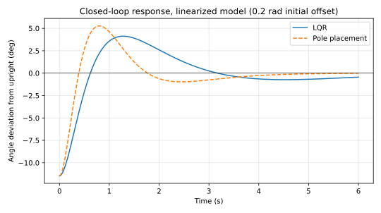
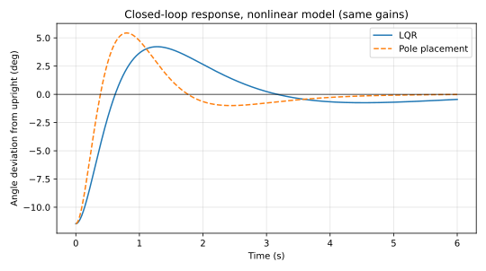

# Cart-Pole Control

Nonlinear modelling, linearization, stability and controllability analysis of
an **inverted pendulum on a cart** — the canonical underactuated control
benchmark — plus a feedback design study (LQR vs. pole placement) for the
upright position.

## The problem

A pendulum mounted on a motorized cart has two equilibria: hanging straight
down and balanced upright. The upright position is the one that matters for
control (balancing a broom on your palm is the same physics), but designing a
controller for it first means answering three questions:

1. How does the true nonlinear system behave near each equilibrium?
2. When is the linearized model a trustworthy approximation of it?
3. Can the system be controlled at all through a single force input on the cart?

## Approach

- **Nonlinear model** — full equations of motion integrated numerically;
  free-response simulations from several initial conditions (small/large
  displacement from hanging, near-upright release, spinning release).
- **Linearization** — state-space models derived about both equilibria
  (hanging θ = 0 and inverted θ = π, deviation variables for the inverted case).
- **Stability analysis** — eigenvalue analysis of both linearized models.
- **Validation** — nonlinear vs. linearized responses compared side by side,
  plus a phase-plane portrait about the hanging equilibrium, to show where the
  linear model holds and where it breaks down.
- **Controllability** — rank test on C = [B, AB, A²B, A³B] for both equilibria.
- **Feedback design** (Python) — two full-state feedback laws u = −Kz for the
  inverted position: an LQR design and a pole-placement design, compared on
  the linearized model and then verified on the nonlinear model.

**Parameters:** cart mass M = 4 kg, pendulum mass m = 0.6 kg, arm length
L = 1.2 m, viscous damping δ = 0.4, g = 9.81 m/s².
State: `[x; v; θ; ω]`, with θ measured from the downward position.

## Results

### Stability and controllability

| Equilibrium | Eigenvalues | Verdict |
|---|---|---|
| Hanging (θ = 0) | 0, −0.087, −0.0065 ± 3.066i | Stable — damped oscillation back to rest |
| Inverted (θ = π) | 0, **+3.060**, −0.087, −3.073 | Unstable — one positive real eigenvalue, falls away |

Both equilibria are **fully controllable** (rank(C) = 4), so a single
cart-force input is enough, in principle, to stabilize the inverted pendulum.
The linearized model tracks the nonlinear response closely near the hanging
equilibrium, and diverges near the upright position exactly as the unstable
eigenvalue predicts.

### Feedback design (Python)

Both controllers start from a 0.2 rad offset from upright, matching the
free-response study:

| Design | Gain K = [k_x, k_v, k_θ, k_ω] | Closed-loop poles | Settling time (\|θ\| < 0.02 rad) | Peak cart excursion | Peak force |
|---|---|---|---|---|---|
| LQR, Q = diag(10, 1, 100, 1), R = 1 | [−3.16, −8.03, 133.59, 44.49] | −0.59 ± 0.56i, −3.09 ± 0.32i | 2.5 s | 1.00 m | 26.7 N |
| Pole placement at {−1.5, −2, −3 ± i} | [−14.68, −26.33, 225.94, 76.72] | as placed | 1.5 s | 0.60 m | 45.2 N |

The pole-placement design settles about a second faster and keeps the cart
closer to the origin, at the cost of roughly 70% more peak control effort.
Both gains also stabilize the **nonlinear** model from the same initial
offset — the pendulum stays up under either controller.





## Repository layout

- `matlab/cartpole_analysis.m` — the original analysis in MATLAB: nonlinear
  simulations, linearization, eigenvalues, model comparison, phase plane,
  controllability. Self-contained (the `pendcart` dynamics are included as a
  local function).
- `python/cartpole.py` — Python port of the model: nonlinear dynamics,
  analytic linearization, eigenvalue and controllability analysis.
- `python/control_design.py` — LQR and pole-placement designs, closed-loop
  simulation on both the linear and nonlinear models, and the figures above.

## How to run

MATLAB (R2023a or later, base MATLAB only):

```matlab
run matlab/cartpole_analysis.m   % prints eigenvalues and controllability ranks, opens 7 figures
```

Python (3.10+):

```bash
pip install -r requirements.txt
python python/cartpole.py        % eigenvalues and controllability ranks
python python/control_design.py  % gains, response metrics, and figures
```

## Background

Started as a university project in data-driven control; extended here with a
Python implementation and the feedback design comparison.
